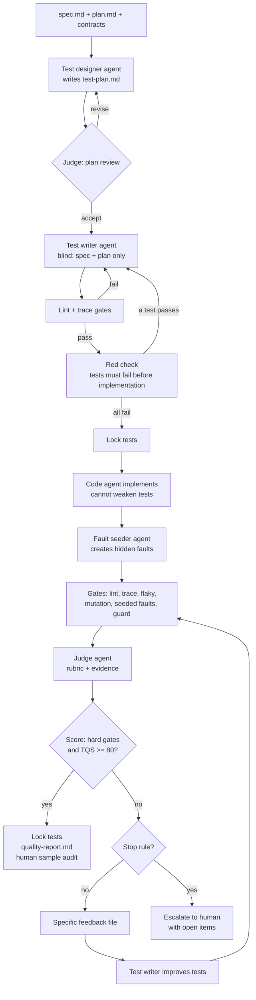

# Why qestack: measuring the quality of AI-written tests

**An approach, a metric catalog and an independent evaluation loop for tests that AI agents write**

| | |
|---|---|
| Audience | Test automation architects, QA leads, engineering managers |
| Scope | Any stack. Examples use Java (Maven, JUnit 5, HTTP API, database, Kafka, Playwright) and .NET |
| Tool | qestack (engine, Claude Code plugin, stacks, rulesets, rubrics) |
| Writing style | Simplified Technical English (short sentences, one idea per sentence) |

---

## Contents

1. Executive summary
2. The problem: why "green and 100% covered" is not evidence
3. Root causes in AI-generated tests
4. Design principles
5. The metric catalog
6. The scorecard: hard gates and the Test Quality Score
7. The independent evaluation and improvement loop
8. Guardrails against gaming
9. How a human reviews without reading every line
10. Workflow, with and without speckit
11. Stack-specific guidance (Java, API, database, Kafka, Playwright, .NET)
12. Rollout plan
13. Limits and risks
14. Glossary
15. Quick reference card

---

## 1. Executive summary

Code coverage shows that a test **executed** a line. A green build shows that no assertion **failed**. Neither shows that the tests can **detect a defect**. AI agents make this gap larger. An agent can produce many tests very fast. Many of these tests look correct but check very little.

You can trust AI-built tests when you have evidence for three questions:

1. **Traceability.** Does each requirement have tests of the correct types (positive, negative, boundary, error)?
2. **Fault detection.** Do the tests fail when the behavior is wrong? Mutation testing and seeded faults measure this.
3. **Independent review.** Did a separate agent, with a calibrated rubric, check the tests against the specification and find no serious defects?

This document defines metrics for each question. It combines them into **hard gates** and a weighted **Test Quality Score (TQS)**. It then defines a closed loop. In the loop, one agent writes tests, automated gates and an independent judge evaluate them, and specific feedback goes back to the writer. The loop continues until the tests meet the quality bar, or until it stops and asks a human.

The most important single change is this: **the agent that writes tests must work from the specification, not from the implementation.** Tests that come from the code confirm what the code does. They do not show what the code must do.

---

## 2. The problem: why "green and 100% covered" is not evidence

### 2.1 Coverage measures execution, not verification

Look at this test:

```java
@Test
void calculatesDiscount() {
    var result = pricing.applyDiscount(order);
    assertNotNull(result);
}
```

This test executes every line in `applyDiscount`. Line coverage can be 100%. But the test passes if the discount is 0%, 10% or 90%. The test cannot find a defect in the discount rule.

### 2.2 A passing test is not a correct test

A test passes in two cases:

- The code is correct and the test checks the correct thing.
- The test checks nothing, or it checks the wrong thing.

A pass rate cannot separate these two cases. Only a test that **fails on wrong behavior** gives evidence.

### 2.3 Why this gets worse with AI agents

- **Volume.** An agent writes hundreds of tests in minutes. Human review cannot keep up.
- **Plausibility.** The tests have good names, good structure and good comments. They look correct.
- **Confirmation bias.** When the agent can see the implementation, it writes tests that match the implementation. If the implementation has a bug, the test copies the bug into the expected value.
- **Goal pressure.** When you tell an agent "make the tests pass", it can make the tests weaker, skip them or delete them. This is the fastest path to the goal.
- **Self-assessment.** When the same agent writes and evaluates the tests, it gives itself a high score.

### 2.4 Symptoms you already see

| Symptom | What it shows |
|---|---|
| Tests confirm the existing code instead of finding bugs | Code-derived oracles |
| Some requirements have no tests | No enforced traceability |
| Tests check only the status code or "not null" | Weak assertions |
| Empty test methods or steps with no body | Hollow tests |
| You cannot trust the result without reading all the code | No independent, evidence-based evaluation |

---

## 3. Root causes in AI-generated tests

| # | Root cause | Description | Metric that detects it |
|---|---|---|---|
| RC1 | Code-derived oracle | The expected value comes from the implementation, not from the specification. | Code-mirroring rate, spec-sourced oracle rate, red-before-green |
| RC2 | Weak assertions | The test executes code but checks little. | Trivial and shallow assertion rate, mutation score |
| RC3 | Hollow tests | Empty bodies, `TODO`, skipped tests. | Hollow test rate, skip rate |
| RC4 | Requirement gaps | No link from each requirement to tests. | Requirement coverage, requirement depth |
| RC5 | Happy-path bias | Only positive cases. No negative, boundary or error cases. | Requirement depth, seeded-fault detection |
| RC6 | Self-grading | The writer evaluates its own work. | Judge independence, judge calibration |
| RC7 | Gaming | The agent weakens or removes tests to get a green build. | Diff guard, lock violations |
| RC8 | Non-determinism | Tests pass or fail at random. | Flakiness rate |
| RC9 | Over-mocking | The test mocks the unit under test, or checks only mock calls. | Over-mocking rate, judge independence score |

---

## 4. Design principles

### P1. Write tests from the specification

The test agent reads the specification, the API contracts and the data model. It does not read the implementation of the feature. When tests are written before the implementation exists, this is automatic. For changes to existing code, the agent reads only public signatures.

### P2. Separate the roles

Use different agents with different contexts:

| Role | Reads | Writes | Must not |
|---|---|---|---|
| Test designer | Spec, plan, contracts | Test plan | Read implementation |
| Test writer | Test plan, contracts, test utilities | Test code | Read implementation of the feature, edit production code |
| Code writer | Spec, plan, tasks, tests | Production code | Edit or weaken tests |
| Fault seeder | Spec, implementation | Fault patches | Edit tests, share faults with the writer |
| Judge | Spec, test plan, tests, gate results, implementation | Verdicts and findings | Edit any code |

If possible, use a different model, or a different model configuration, for the judge.

### P3. Measure fault detection, not execution

A test has value only if it fails when the behavior is wrong. Mutation testing, seeded faults and red-before-green checks measure this directly.

### P4. Make evidence small and specific

A human must not read every line. The system produces a short report with gates, scores and exceptions. Each finding points to a file and a line.

### P5. Lock the gates

The agent cannot change thresholds, rubrics, the specification, the gate tool or approved tests. Hooks enforce this during the session. The CI pipeline enforces it again.

### P6. Feedback must be specific

"Improve the tests" does not work. "Mutant 14 survived: `>` changed to `>=` in `DiscountService.java:42`, requirement FR-007" works.

### P7. Treat a found bug as success

When a test fails because the production code is wrong, the system must report the bug. It must not change the test to match the code.

---

## 5. The metric catalog

Each metric has an ID, a definition, a formula, a source, a default target and a gate type.

- **Hard gate**: The work fails if the metric misses the target.
- **Scored**: The metric adds to the Test Quality Score.
- **Monitor**: You watch the trend. It does not block.

All targets are starting values. Calibrate them after 2 to 3 sprints of data.

### 5.1 Group A: Requirement traceability ("Is the right thing tested?")

#### A1. Requirement coverage

- **Definition:** The share of required requirement IDs that at least one test covers.
- **Formula:** `covered required IDs / total required IDs`
- **Source:** Requirement IDs in `spec.md` (for example `FR-001`), acceptance scenarios (derived as `US1-AS2`), edge cases in the test plan (`EC-01`). Test tags (for example `@Tag("FR-001")`).
- **Target:** 100%
- **Gate:** Hard

#### A2. Requirement depth

- **Definition:** The share of requirements that have all required test categories.
- **Formula:** `IDs with required categories present / total required IDs`
- **Rule:** The test plan states the categories for each ID. Without a plan, the default rule is: at least 1 positive test and at least 1 negative, boundary or error test.
- **Target:** ≥ 90%
- **Gate:** Scored

#### A3. Orphan test rate

- **Definition:** Tests in the feature scope that have no requirement ID.
- **Formula:** `tests without ID / total tests in scope`
- **Target:** ≤ 5%
- **Gate:** Monitor. An orphan test often tests implementation details.

#### A4. Unknown ID rate

- **Definition:** Tests that reference an ID that does not exist in the spec or the test plan.
- **Target:** 0
- **Gate:** Monitor. It usually shows a typo or an invented requirement.

### 5.2 Group B: Fault detection ("Can the tests find bugs?")

#### B1. Mutation score on changed code

- **Definition:** A mutation tool makes small changes (mutants) to the production code. For example, it changes `>` to `>=`, removes a method call or returns a default value. Then it runs the tests. A mutant is "killed" when at least one test fails.
- **Formula:** `killed / (killed + survived + no coverage)`. Exclude mutants that a human marked as equivalent.
- **Tools:** PIT (Java), Stryker.NET (.NET), Stryker (JavaScript/TypeScript), mutmut (Python).
- **Scope:** Only the files that the feature changed. A full-project run is too slow for each feature.
- **Target:** ≥ 75%. Use ≥ 85% for critical modules (money, security, data integrity).
- **Gate:** Hard and scored.
- **Why it matters:** This is the best available replacement for code coverage. Each surviving mutant is a concrete defect that the tests cannot detect.

#### B2. Seeded-fault detection rate

- **Definition:** A separate agent injects realistic, requirement-level faults into the production code. Examples: an inverted business rule, a missing validation, a wrong error code, a missing database write, a missing Kafka event, a wrong message key. Each fault is a patch. The tool applies one patch at a time, runs the feature tests and reverts the patch.
- **Formula:** `detected faults / valid faults` (a valid fault compiles)
- **Target:** ≥ 90%
- **Gate:** Hard and scored.
- **Why it matters:** Mutation tools make syntactic changes. Seeded faults are semantic. They test the integration layers (database, Kafka, HTTP) where mutation testing is slow.
- **Rule:** The test writer never sees the fault details. It receives only "a fault in FR-004 was not detected".

#### B3. Red-before-green rate

- **Definition:** Each new test must fail before the feature exists. A test that passes on a stub or on the old code checks nothing new.
- **Formula:** `new tests that fail on the pre-implementation code / new tests`
- **Target:** 100%. A human can approve an exemption for behavior that already exists.
- **Gate:** Hard.

#### B4. Checked coverage (optional)

- **Definition:** The share of executed lines whose result reaches an assertion.
- **Gate:** Monitor. Mutation score gives the same signal with less tooling. Use this only if you already have the tooling.

### 5.3 Group C: Assertion strength ("Does the test check enough?")

#### C1. Hollow test rate

- **Definition:** Tests with an empty body, a body with only comments, or a body with no executable statement.
- **Target:** 0
- **Gate:** Hard.

#### C2. No-assertion rate

- **Definition:** Tests with code but no assertion. The tool also counts calls to helper methods that contain assertions, and project-specific assertion methods.
- **Target:** 0
- **Gate:** Hard.

#### C3. Trivial assertion rate

- **Definition:** Tests whose only assertions check existence or type. Examples: `assertNotNull(x)`, `assertThat(x).isNotNull()`, `assertTrue(true)`, `assertDoesNotThrow(...)`.
- **Target:** ≤ 5%
- **Gate:** Scored.

#### C4. Shallow assertion rate

- **Definition:** API tests whose only assertion is the HTTP status code. UI tests whose only assertion is "element is visible".
- **Target:** ≤ 10%
- **Gate:** Scored.

#### C5. Skipped or disabled tests

- **Definition:** Tests with `@Disabled`, `[Fact(Skip=...)]`, `[Ignore]` or similar in the feature scope.
- **Target:** 0 new skips
- **Gate:** Hard.

#### C6. Assertion depth (judge)

- **Definition:** The judge checks that each test verifies all observable effects of the behavior. For an API call this is the status, the response body fields, the headers, the database state and the published events.
- **Gate:** Scored (rubric dimension R3).

### 5.4 Group D: Independence ("Does it test the requirement or the code?")

#### D1. Code-mirroring rate

- **Definition:** Tests that compute the expected value with the same logic as the implementation. Example: the test calls `price * (1 - rate)` to get the expected price, and the implementation uses the same formula. If the formula is wrong, the test is wrong too.
- **Source:** Judge (rubric dimension R5).
- **Target:** ≤ 5%
- **Gate:** Scored.

#### D2. Spec-sourced oracle rate

- **Definition:** The share of expected values that you can trace to a specification example, a business rule or a contract.
- **Source:** Judge (rubric dimension R2).
- **Target:** ≥ 80%
- **Gate:** Scored.

#### D3. Over-mocking rate

- **Definition:** Tests that mock the unit under test, or that only verify mock interactions and no real outcome.
- **Source:** Judge.
- **Target:** ≤ 10%
- **Gate:** Scored.

### 5.5 Group E: Reliability

#### E1. Flakiness rate

- **Definition:** Run the feature tests N times (default 5, use 10 for critical work) in random order. A test is flaky if its result changes.
- **Formula:** `flaky tests / tests in scope`
- **Target:** 0 for new tests
- **Gate:** Hard.

#### E2. Consistent failures

- **Definition:** Tests that fail in all runs after implementation.
- **Gate:** Hard. Each one is either a test defect or a product bug. The loop must classify it. It must not hide it.

### 5.6 Group F: Maintainability (test smells)

| Smell | Example | Why it is bad |
|---|---|---|
| Fixed sleep | `Thread.sleep(2000)`, `Task.Delay`, `waitForTimeout` | Slow and flaky. Use polling with a timeout. |
| Conditional logic | `if` or `for` in the test body | The test can skip its own assertions. |
| Swallowed exception | `catch (Exception e) {}` | Hides failures. |
| TODO in test | `// TODO assert response` | The test is not finished. |
| Magic values with no source | `assertEquals(42.17, total)` | The reader cannot check the oracle. |
| Very long test | More than one behavior in one test | Hard to diagnose. |

- **Metric:** Share of tests in scope with at least one smell.
- **Target:** ≤ 10%, and no new swallowed exceptions.
- **Gate:** Scored.

### 5.7 Group G: Outcome and trust (long term)

#### G1. Escaped defect rate

- **Definition:** Defects found in UAT or production for a requirement that already had tests.
- **Use:** Do a root-cause check on each escape. Add the missing case to the test plan template or the rubric.
- **Gate:** Monitor (team KPI).

#### G2. Human audit agreement

- **Definition:** Each sprint, a human reviews a sample of tests: 5 random tests plus the 5 tests with the lowest judge score. The human gives the same verdicts as the judge (accept, revise, reject).
- **Formula:** `tests where human verdict = judge verdict / tests sampled`
- **Target:** ≥ 90%
- **Gate:** Monitor.

#### G3. Judge calibration (Cohen's kappa)

- **Definition:** Agreement between the judge and the human, corrected for chance.
- **Target:** κ ≥ 0.7
- **Rule:** If κ < 0.6, do not trust the judge scores. Fix the rubric or the judge prompt first.
- **Gate:** Monitor. It controls how much you trust group D.

#### G4. Bugs found by tests

- **Definition:** The number of product defects that the new tests found before merge.
- **Use:** This is a positive signal. Report it. Do not punish it.

---

## 6. The scorecard: hard gates and the Test Quality Score

### 6.1 Hard gates

All hard gates must pass. If one fails, the work is not accepted, whatever the score.

| Gate | Default |
|---|---|
| G-TRACE: Requirement coverage | = 100% |
| G-HOLLOW: Hollow tests | = 0 |
| G-NOASSERT: Tests without assertions | = 0 |
| G-SKIP: Skipped tests in scope | = 0 |
| G-RED: Red-before-green | = 100% of tests written in the test-write phase |
| G-FLAKY: Flaky tests | = 0 |
| G-GREEN: Consistently failing tests | = 0, or each one is a reported product bug |
| G-MUTATION: Mutation score on changed code | ≥ 75% |
| G-SEED: Seeded-fault detection | ≥ 90% |
| G-GUARD: Guard violations (weakened tests, protected files) | = 0 |
| G-JUDGE: Tests with a "reject" verdict | = 0 |

### 6.2 Test Quality Score (TQS)

The TQS is a weighted score from 0 to 100.

| Dimension | Weight | Inputs |
|---|---|---|
| Fault detection | 35% | 60% mutation score + 40% seeded-fault detection |
| Requirement depth | 25% | 50% requirement coverage + 50% requirement depth |
| Assertion strength | 15% | 50% lint (1 − trivial/shallow/no-assert rate) + 50% judge R2 and R3 |
| Independence | 15% | Judge R5 (independence) |
| Maintainability | 10% | 1 − smell rate, combined with judge R6 and R7 |

**Accept** when all hard gates pass and TQS ≥ 80.

The engine (`qestack score`) computes these numbers. The weights and thresholds are in the core defaults. A project changes them in `.qestack/project.toml`.

### 6.3 Why gates and a score

- Gates catch serious defects. One hollow test is never acceptable, whatever the average.
- The score shows trends and lets you compare features and teams.
- Together they stop the "good average hides a bad test" problem.

---

## 7. The independent evaluation and improvement loop

### 7.1 The full flow



### 7.2 Phase details

**Phase 1: Test design (before code).** The designer reads the spec and writes a test plan. The plan lists each requirement ID, the test cases, the category of each case (positive, negative, boundary, error, security, contract), the layer (unit, API, database, Kafka, UI) and the oracle source. The judge reviews the plan with the plan rubric. Plan defects are cheap to fix at this point.

**Phase 2: Test writing (blind).** The writer implements the plan. It reads only the plan, the contracts, the data model and existing test utilities. It can create minimal stubs (signatures that throw "not implemented") so that the tests compile.

**Phase 3: Red check.** The tool runs the new tests. Each must fail. A test that passes before the feature exists is not testing the feature.

**Phase 4: Lock.** The tool records a snapshot of the tests. After this point, a hook blocks any edit that removes a test, removes an assertion, adds a skip or removes a requirement tag.

**Phase 5: Implementation.** The code agent writes the production code. It cannot weaken the tests. If it thinks that a test is wrong, it reports this. A human or the judge decides.

**Phase 6: Fault seeding.** A separate agent reads the spec and the implementation. It writes 5 to 15 realistic faults as patches. The writer never sees them.

**Phase 7: Gates and judge.** The tool runs all automated gates. Then the judge reviews each test with the rubric, the gate results and the redacted fault results.

**Phase 8: Feedback and improvement.** The tool writes a feedback file with specific items: surviving mutants with file and line, uncovered requirement IDs, missing categories, undetected fault areas, flaky tests and judge findings. The writer improves the tests. Strengthening is allowed. Weakening is blocked.

**Phase 9: Stop.** The loop stops when:

- all hard gates pass and TQS ≥ 80 (accept), or
- the maximum number of iterations is reached (default 4), or
- the TQS does not improve by at least 2 points in 2 iterations.

In the last two cases, a human gets the report with the open items.

### 7.3 The judge rubric (summary)

The judge scores each test from 0 to 4 on seven dimensions. Each score must quote evidence (file and line).

| ID | Dimension | 4 means |
|---|---|---|
| R1 | Requirement fidelity | The test checks exactly the behavior that the requirement states. |
| R2 | Oracle correctness | Expected values come from the spec, a contract or an independent calculation. |
| R3 | Assertion depth | All observable effects are checked: response, state, events, errors. |
| R4 | Negative and edge coverage | The requirement group has the negative and boundary cases that the plan needs. |
| R5 | Independence | No mirrored logic. No mocking of the unit under test. |
| R6 | Determinism and isolation | No sleeps, no shared state, no order dependence, own test data. |
| R7 | Clarity | Name and structure show the intent. A reader can see the oracle. |

**Verdict rules:**

- Any dimension = 0 → **reject**
- Any dimension = 1 → at least **revise**
- R1 < 3 or R2 < 3 → at least **revise**
- Average < 2.5 → at least **revise**
- Otherwise → **accept**

The full rubric with score anchors: `qestack show rubrics/test-judge`.

### 7.4 Why the judge can be trusted (and when it cannot)

An LLM judge has known biases. It can prefer long tests. It can agree with confident text. It can miss subtle oracle errors. The design controls these risks:

- **Evidence requirement.** A score without a file and line reference is invalid.
- **Skeptical stance.** The prompt tells the judge to assume that each test is wrong until evidence shows that it is correct.
- **Objective anchors.** The judge receives the mutation and fault results. It cannot give R3 = 4 to a test in a class with many surviving mutants on the same lines.
- **Different context.** The judge did not write the tests.
- **Calibration.** Humans label a sample each sprint. You compute agreement and kappa. If agreement drops, you fix the rubric.

---

## 8. Guardrails against gaming

An agent that must "pass the gates" will find shortcuts. qestack blocks the common ones:

| Shortcut | Control |
|---|---|
| Delete a failing test | Guard: method removed → violation |
| Remove or weaken assertions | Guard: assertion count decreased → violation |
| Add `@Disabled` or `Skip` | Lint + guard: skip added → violation |
| Remove a requirement tag to hide a gap | Guard: trace tag removed → violation |
| Change thresholds or rubrics | Hook blocks edits to protected files. CI guard checks again. |
| Mark surviving mutants as "equivalent" | Only humans can edit the equivalent-mutant list (protected path). |
| Change the expected value to match buggy code | Guard reports changed assertions for human review. The writer must log suspected bugs, not change the oracle. |
| Write tests for the seeded faults only | The writer never sees fault details. |
| Edit production code to make a test pass (test writer) | Writer rules. The guard reports production changes during test phases. |
| Edit tests to make code pass (code agent) | Locked tests. Hook blocks weakening edits. |

**Enforcement layers:**

1. **Agent instructions.** Each agent has explicit "must not" rules.
2. **Claude Code hooks.** A `PreToolUse` hook blocks edits to protected files and weakening edits to locked tests.
3. **CI gate.** The CI pipeline runs the guard against the main branch. This is the final authority. A hook can be bypassed with a shell command. The CI check cannot.
4. **Code owners.** Put the protected paths under CODEOWNERS so that a human must approve changes.

---

## 9. How a human reviews without reading every line

Each feature produces `specs/<feature>/quality-report.md`. A reviewer reads it in 5 to 10 minutes:

1. **Gate table.** All hard gates and their values.
2. **TQS and trend.** The score for each iteration.
3. **Traceability matrix.** Each requirement ID, its tests and its categories.
4. **Surviving mutants.** File, line and mutation. Each one is a possible missed defect.
5. **Undetected seeded faults.** With full details (the human can see them).
6. **Judge findings.** Rejected and revised tests, with evidence.
7. **Suspected product bugs.** Tests that fail because the code is wrong.
8. **Items for human decision.** Changed assertions, equivalent-mutant candidates, red-check exemptions.
9. **Audit sample.** 5 random tests and the 5 lowest-scored tests. Read only these.

**Review rules:**

- Read the exceptions, not the full code.
- Read the audit sample. Record your verdict for each test in `human-audit.json`.
- The tool computes judge agreement from your verdicts. Over time this tells you how much to trust the judge.

---

## 10. Workflow, with and without speckit

### 10.1 Phase sequence

qestack works with or without speckit. The skills are the same.

| Step | Without speckit | With speckit | Output |
|---|---|---|---|
| 1 | Write `specs/<NNN-name>/spec.md` | `/speckit.specify`, `/speckit.clarify` | `spec.md` with `FR-###` IDs and acceptance scenarios |
| 2 | `/qe-grill-spec` | `/qe-grill-spec` (optional) | Testable requirements |
| 3 | `/qe-plan` | `/speckit.plan`, then `/speckit.testplan` | `test-plan.md` + independent plan review |
| 4 | `/qe-write`, `/qe-prove` | `/speckit.tasks`, then `/speckit.testwrite` | Blind tests, red check, lock |
| 5 | Implement the feature | `/speckit.implement` | Production code. Tests are locked. |
| 6 | `/qe-harden` | `/speckit.testquality` | Gates, judge, loop, `quality-report.md` |

### 10.2 Requirement IDs

- Speckit already writes functional requirements as `FR-001`, `FR-002` and so on. Keep these.
- Acceptance scenarios have no IDs. The tool derives them: scenario 2 of user story 1 is `US1-AS2`.
- Edge cases get IDs in the test plan: `EC-01`, `EC-02`.
- Speckit restarts `FR` numbers for each feature. So each test also gets a feature tag, for example `feature-003`. The tool uses the feature tag to scope all metrics.

### 10.3 Tag convention

Java (JUnit 5):

```java
@Tag("feature-003")
class OrderDiscountApiTest {

    @Test
    @Tag("FR-007") @Tag("US1-AS2") @Tag("boundary")
    @DisplayName("TC-014: discount is not applied when the order total equals the threshold")
    void noDiscountAtExactThreshold() { ... }
}
```

.NET (xUnit):

```csharp
[Trait("Category", "feature-003")]
public class OrderDiscountApiTests
{
    [Fact]
    [Trait("Category", "FR-007")] [Trait("Category", "boundary")]
    public async Task TC014_NoDiscountAtExactThreshold() { ... }
}
```

---

## 11. Stack-specific guidance

### 11.1 Java, Maven, JUnit 5

- **Mutation tool:** PIT with the JUnit 5 plugin. Run it only on the classes the feature changed (`targetClasses`). Use the `STRONGER` mutator group.
- **Integration tests and PIT:** PIT runs the tests once for each mutant. Tests that start containers (database, Kafka) are slow under PIT. Run PIT on unit and component tests. Use seeded faults to measure the integration tests.
- **Random order:** Set `junit.jupiter.testmethod.order.default` and `junit.jupiter.testclass.order.default` to the random orderers for the flakiness runs.
- **Feature filter:** Use a Maven property for the JUnit 5 tag expression in Surefire and Failsafe (`<groups>${qe.groups}</groups>`).

### 11.2 API testing with an internal HTTP client library

- Register the assertion helpers of your library in `project.toml`. If you do not, the lint gate reports false "no assertion" findings.
- Each API test must check more than the status: body fields with exact expected values, error payload structure, important headers.
- Each endpoint needs negative tests: invalid input, missing fields, wrong types, authorization failures, not found, conflict.
- Check idempotency where the contract requires it.
- After a write operation, check the database or a follow-up GET. A 201 status does not prove that the data was saved.

### 11.3 Database testing

- Check the persisted state with a query. Check all important columns, not only the row count.
- Check constraints: unique keys, foreign keys, not-null columns.
- Check transaction behavior: a failed operation must not leave partial data.
- Isolate test data. Use Testcontainers or a transaction rollback. Do not depend on data from other tests.
- Seeded faults for this layer: missing save, wrong column mapping, missing transaction, wrong status value.

### 11.4 Kafka testing

- Check the event key, value, headers and schema version. Not only "a message arrived".
- Check that there are no extra or duplicate events.
- Check ordering when the contract requires it (same key, same partition).
- For consumers: check idempotency, poison message handling and the dead-letter topic.
- Use polling with a timeout (for example Awaitility). Never use a fixed sleep.
- Use a unique consumer group and unique topic or key for each test, so tests do not see each other's events.
- Seeded faults for this layer: event not published, wrong key, missing header, published before the database commit, duplicate publish.

### 11.5 Playwright (future UI tests)

- Use web-first assertions (`assertThat(locator).hasText(...)`). They retry automatically.
- Do not use `waitForTimeout`. Do not use fixed sleeps.
- Use role-based and test-id locators. Avoid long CSS or XPath paths.
- A UI test must check a business outcome, not only that an element is visible.
- Keep UI tests few. Put most behavior tests at the API layer. They are faster and more stable.
- Mutation testing does not apply well to UI tests. Use seeded faults and the judge.

### 11.6 .NET

- **Mutation tool:** Stryker.NET with `--since` to limit it to changed code.
- **Test frameworks:** xUnit, NUnit or MSTest. qestack recognizes all three.
- **Reports:** Use a JUnit XML logger so that the same tool parses the results.
- **Tags:** `[Trait("Category", "...")]`, `[Category("...")]` or `[TestCategory("...")]`.

---

## 12. Rollout plan

| Stage | Duration | Actions | Exit criteria |
|---|---|---|---|
| 0. Baseline | 1 week | Run lint, trace and mutation on 2 to 3 existing features. Do not block. | You know the current numbers. |
| 1. Static gates | 1 to 2 sprints | Turn on hollow, no-assertion, skip and trace gates as hard gates. Add the tag convention. | No hollow tests in new work. |
| 2. Spec-first tests | 1 to 2 sprints | Add `/speckit.testplan` and `/speckit.testwrite`. Add the red check and locks. | All new features have a test plan and red evidence. |
| 3. Fault detection | 2 sprints | Turn on mutation and seeded faults. Start with lower thresholds (60%, 75%). Raise them each sprint. | Thresholds at target values. |
| 4. Judge and loop | 2 sprints | Turn on the judge and the improvement loop. Do human audits each sprint. | Judge agreement ≥ 90%, κ ≥ 0.7. |
| 5. CI enforcement | Continuous | Run the gates in CI. Add CODEOWNERS for protected paths. | Gate failures block merges. |

Track these team KPIs over time: mean TQS, mutation score, seeded-fault detection, escaped defects, judge agreement, bugs found before merge.

---

## 13. Limits and risks

- **Mutation testing cost.** It can be slow. Limit it to changed classes. Exclude container-based tests. Run the full project at night.
- **Equivalent mutants.** Some mutants do not change behavior. They always survive. A human must mark them. Do not let agents do it.
- **Fault seeder quality.** If the seeder writes only easy faults, the metric is too high. The judge reviews the fault catalog. Rotate the seeder prompt over time.
- **Judge bias.** The judge is a model. It can be wrong. Calibration with human audits is not optional.
- **Spec quality.** If the specification is vague, the tests cannot have good oracles. Use `/speckit.clarify`. The designer lists open questions and does not guess.
- **Hooks are not security.** A determined agent can bypass a hook through the shell. CI is the authority.
- **Static analysis limits.** The lint uses patterns, not a full parser. It can miss unusual code. The judge and mutation testing cover the gaps.
- **Metric gaming in general.** Each metric can be gamed alone. The combination of mutation, seeded faults, red checks, guards and an independent judge is hard to game together.

---

## 14. Glossary

| Term | Meaning |
|---|---|
| Oracle | The source of the expected result in a test. |
| Mutant | A copy of the code with one small change. |
| Killed mutant | A mutant that makes at least one test fail. |
| Surviving mutant | A mutant that no test detects. |
| Equivalent mutant | A mutant that does not change behavior. No test can kill it. |
| Seeded fault | A realistic defect that an agent puts into the code on purpose, to check the tests. |
| Red-before-green | A new test fails before the feature exists, then passes after. |
| Hollow test | A test with no executable statements. |
| Judge | An independent agent that reviews tests with a rubric. |
| TQS | Test Quality Score, a weighted score from 0 to 100. |
| Lock | A snapshot of approved tests. Edits that weaken them are blocked. |

---

## 15. Quick reference card

**Accept the AI-built tests when all of these are true:**

- [ ] Each required requirement ID has at least one test (100%).
- [ ] Each requirement has the categories that the test plan needs.
- [ ] No hollow tests, no tests without assertions, no skipped tests.
- [ ] Each test from the test-write phase failed before the implementation.
- [ ] No flaky tests in 5 random-order runs.
- [ ] Mutation score on changed code ≥ 75%.
- [ ] Seeded-fault detection ≥ 90%.
- [ ] No guard violations.
- [ ] No test with a "reject" verdict from the judge.
- [ ] TQS ≥ 80.
- [ ] A human read the audit sample and the exceptions in the report.

**Do not accept when:**

- the only evidence is "all tests pass" and "coverage is high", or
- the agent that wrote the tests also graded them, or
- any test was weakened, skipped or deleted to get a green build.
